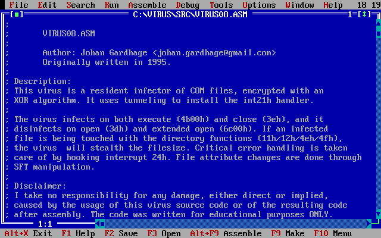

# dos-virus

Retro programming in Borland Turbo Assembler 4



## Prerequisites

To build and run the Borland Turbo Assembler virus programs, you must first install the following tools:

- [DOSBox Staging](https://www.dosbox-staging.org/)
- [Borland Turbo Assembler](https://winworldpc.com/product/turbo-assembler/4x)
- [ASM Edit](http://www.o-love.net/asmedit/ae_down.html)

### Install DOSBox Staging

#### Ubuntu

```
$ sudo add-apt-repository ppa:feignint/dosbox-staging
$ sudo apt update
$ sudo apt install dosbox-staging 7zip
```

#### macOS

```
$ brew install dosbox-staging sevenzip
```

#### Configuration

When starting `dosbox-staging` the first time, the configuration file `dosbox-staging.conf` will be generated in

- Ubuntu: `~/.config/dosbox/dosbox-staging.conf`
- macOS: `~/Library/Preferences/DOSBox/dosbox-staging.conf`

### Install Borland Turbo Assembler

1. Download [Borland Turbo Assembler 4.0 (3.5-1.44mb).7z](https://dl.winworldpc.com/Borland%20Turbo%20Assembler%204.0%20(3.5-1.44mb).7z)
   ```
   $ curl -o "Borland Turbo Assembler 4.0 (3.5-1.44mb).7z" "https://dl.winworldpc.com/Borland%20Turbo%20Assembler%204.0%20(3.5-1.44mb).7z"
   ```

1. Extract the downloaded Borland Turbo Assembler archive
   ```
   $ 7zz x "Borland Turbo Assembler 4.0 (3.5-1.44mb).7z"
   ```

1. Extract the Borland Turbo Assembler disk images
   ```
   $ cd "Borland Turbo Assembler 4.0 (3.5-1.44mb)"/
   $ for i in *.img; do echo $i; 7zz x -y -otasminst $i; done
   ```

1. Move the extracted files to the DOS C: drive
   ```
   $ mkdir -p ~/DOSBox
   $ mv tasminst ~/DOSBox/
   ```

1. Configure DOSBox Staging

   Edit `dosbox-staging.conf` (see [Configuration](#configuration)) and add the following autoexec options
   ```
   [autoexec]
   mount c ~/DOSBox
   path %PATH%;C:\TASM\BIN
   c:
   ```

1. Start `dosbox-staging` and execute the Borland Turbo Assembler installation program
   ```
   $ dosbox-staging
   C:\> cd tasminst
   C:\TASMINST> install.exe
   ```
   In the installation program, select the following options
   ```
   Enter the SOURCE drive to use: C
   Enter the SOURCE Path: \TASMINST
   TASM Directory             [ C:\TASM ]
   Windows Directory          [ C:\WINDOWS ]
   16-bit command line tools  [ Yes ]
   32-bit command line tools  [ No  ]
   Turbo Debugger for Windows [ No  ]
   Turbo Debugger for DOS     [ Yes ]
   Turbo Debugger for Win32   [ No  ]
   Examples                   [ No  ]
   Documentation Files        [ No  ]

   Start Installation
   ```

### Install ASM Edit

1. Download [ASM Edit](http://www.o-love.net/asmedit/ae_down.html)
   ```
   $ curl -O http://www.o-love.net/asmedit/aedt182b.zip
   ```

1. Extract the downloaded ASM Edit archive
   ```
   $ 7zz x aedt182b.zip -oaedtinst
   ```

1. Move the extracted files to the DOS C: drive
   ```
   $ mv aedtinst ~/DOSBox/
   ```

1. Configure DOSBox Staging

   Edit `dosbox-staging.conf` (see [Configuration](#configuration)) and add the following autoexec options
   ```
   [autoexec]
   path %PATH%;C:\ASMEDIT
   ```

1. Start `dosbox-staging` and execute the ASM Edit installation program
   ```
   $ dosbox-staging
   C:\> cd aedtinst
   C:\AEDTINST> install.exe
   ```
   In the installation program, select the following options
   ```
   Press Alt+I to Begin install
   Target path: C:\ASMEDIT
   Press Alt+X to Exit
   ```

## Build virus programs

Link the `dos-virus` git repository to the DOS C: drive
```
$ ln -s ~/git/dos-virus ~/DOSBox/virus
```

#### Build from DOS terminal

1. Execute build script
   ```
   C:\VIRUS> buildall.bat
   ```
   The virus programs will be located in the `C:\VIRUS\BUILD` directory

#### Build from ASM Edit

1. Start ASM Edit
   ```
   C:\VIRUS> asmshell
   ```

1. Configure ASM Edit

   Press `ALT+O` for options

   Select `External programs`, `Assembler`, `user defined`, `Edit` and type in the following options
   ```
   Program title: TASM
   Program path: C:\TASM\BIN\TASM.EXE
   Command line: /w1/m/t !ACMPL,!ANAME,!ANAME
   ```

   Select `External programs`, `Linker`, `user defined`, `Edit` and type in the following options
   ```
   Program title: TLINK
   Program path: C:\TASM\BIN\TLINK.EXE
   Command line: !ANAME!OBJFL,!ANAME!TARGT,!ANAME.MAP,!LIBFL,!MKCOM
   ```

   Select `Directories` and type in the following directories
   ```
   ASM files search path: C:\VIRUS\SRC
   COM, EXE, LIB and OBJ: C:\VIRUS\BUILD
   Includes and Macros: C:\VIRUS\SRC
   ```

   Select `Environment`, `Preferences` and the following options
   ```
   Auto save: [ ] Desktop
   ```

   Select `Environment`, `Editor` and the following options
   ```
   [ ] Create backup files
   ```

   Select `Save ASMEDIT.DSK` to save the configuration

1. Open virus source file

   Press `F3` to open file

1. Build virus program

   Press `Alt-A` and then press `Assemble` to assemble the file

   Press `Alt-A` and then press `Link` to link the file

   The virus programs will be located in the `C:\VIRUS\BUILD` directory

## License

Licensed under MIT license. See [LICENSE](LICENSE) for more information.

## Authors

* Johan Gardhage
